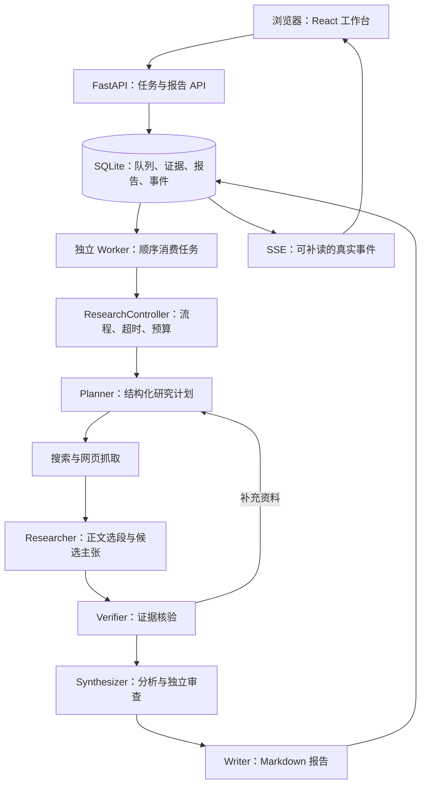
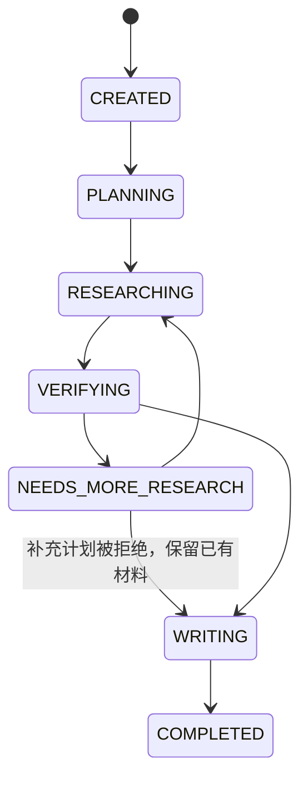

# DeepDive 整体架构与实现说明

版本：当前本地实现快照；整理日期：2026-10-22。本文说明实际代码，不将规划中的能力描述为已实现。

## 1. 项目定位与现状

DeepDive 是本机使用的证据驱动研究工作台。用户提交问题后，系统拆解问题，搜索并抓取资料，提取主张，核验证据，生成带引用的研究报告。产品采用商务报告风格，支持真实进度、取消任务、历史记录、证据追溯和 Markdown 导出。

核心工程链路已建立；研究质量仍在改进。当前阶段不是多用户生产服务，也没有完成远程身份认证、分布式执行和高可用部署。

| 维度 | 当前实现 |
| --- | --- |
| 运行位置 | macOS 本机，默认 `127.0.0.1:8000` |
| 页面 | Next.js 静态导出，由 FastAPI 提供 |
| 后端 | Python、FastAPI、Pydantic |
| 执行器 | 与 API 分离的单 Worker 进程 |
| 数据 | SQLite WAL，正文与证据持久化 |
| 模型 | DeepSeek，通过 Chat Completions 适配调用 |
| 搜索与抓取 | 默认 DeepSeek Search / Fetch；可配置 Tavily 搜索路径 |
| 编排 | Python Controller + 显式状态机 |
| 报告 | 模型综合分析、独立上下文审查、确定性 Markdown 渲染 |
| 质量验证 | 固定 10 题、standard/deep 配对评测与离线测试 |

## 2. 架构与进程边界



日常运行有两个 Python 子进程：Uvicorn API 与研究 Worker，由 `scripts/run_local.py` 统一启动和停止。前端构建完成后不依赖单独的 Node 运行服务。浏览器与 API 同源，不需要另设 CORS。

SQLite 同时承担持久化存储与本地任务队列。API 只负责写入任务；Worker 查找 `CREATED` 任务并顺序执行。关闭浏览器不会取消研究；停止 Worker 会中断执行。Worker 下次启动将遗留执行中任务标记为 `FAILED / worker_restarted`，不会从模型调用中间自动恢复。

这是适合单机的简单架构。它没有消息队列、分布式锁、任务租约或多 Worker 调度。文件锁保证同一数据目录只有一个研究 Worker，不能通过直接多开 Worker 扩容。

## 3. 代码目录与职责

| 位置 | 职责 |
| --- | --- |
| `apps/web/app/` | 首页、任务详情、历史记录、全局商务报告样式 |
| `apps/web/components/` | 导航与任务列表等组件 |
| `apps/web/lib/api.ts` | 前端类型、请求封装、状态名称与安全链接处理 |
| `apps/api/main.py` | 生命周期、配置初始化、安全响应头、静态前端与基础接口 |
| `apps/api/routes/research.py` | 研究任务、报告、证据、取消与 SSE |
| `apps/api/schemas/` | API 输入输出结构 |
| `deepdive/worker.py` | Worker 文件锁、消费循环、停止信号和遗留任务恢复 |
| `deepdive/orchestration/` | 主流程、状态机、配置模型、预算和价格快照 |
| `deepdive/agents/` | 规划、提取、核验、综合分析和报告渲染 |
| `deepdive/providers/` | 模型、搜索和 DeepSeek 工具适配 |
| `deepdive/tools/` | 搜索采集、网页提取和 URL 安全检查 |
| `deepdive/storage/` | SQLite 仓储、数据库初始化、Worker 状态检测 |
| `deepdive/evidence/` | 来源数据结构、采集集合与持久化 |
| `deepdive/evaluation/` | 固定题集运行、指标与策略配置 |
| `evals/` | 固定问题、维度与参考复核规则 |
| `scripts/` | 启动、探测、备份、评测续跑、汇总和显式报告再分析 |
| `tests/` | 离线测试；浏览器测试另位于 `apps/web/tests/` |
| `data/` | 本地研究数据、报告、采集材料与评测产物 |

## 4. 研究任务的完整流程

### 4.1 接收与排队

`POST /api/research` 校验问题和设置，写入 `research_task`，同时记录初始状态事件，返回 HTTP 202。创建接口不会在请求内执行整个研究。

Worker 根据创建时间查找下一条待执行任务，调用 `ResearchController.run(task_id)`。当前生产 Worker 一次执行一个任务；排队时长与执行时长不同。

### 4.2 规划：Planner

入口：`deepdive/agents/planner.py` 的 `plan()`。

模型返回结构化 `Plan`：

```json
{
  "subquestions": [
    {
      "question": "短搜索词",
      "objective": "本次搜索要回答的维度",
      "priority": 1,
      "evidence_type": "所需证据类型"
    }
  ],
  "time_sensitive": false
}
```

Pydantic 限制字段、长度、优先级和子问题数量。standard 通常要求 1–2 条搜索，最多 3 条；deep 要求 3 条互补搜索，覆盖机制、比较、限制或反证。后续规划会收到已有主张和证据缺口。

JSON 模式不能保证返回一定符合业务 Schema，因此 `parse_json()` 还要执行结构验证。校验诊断只记录安全字段路径和错误类型，不保存原始错误输入或未知字段名。

### 4.3 采集：搜索与 Fetch

入口：`SourceCollector.collect()` 与 `providers/registry.py`。

默认创建 DeepSeek Search 和 Fetch 适配器。搜索找到候选链接，Fetch 获取正文，采集层处理来源状态和重复资料。来源保留 URL、规范化 URL、标题、抓取时间、发布日期、正文、内容哈希、错误信息等。

搜索摘要与实际抓取正文不同。主张证据应来自成功获取的正文，不能只凭一个搜索结果标题宣称事实已验证。URL 安全检查与重定向状态也属于来源记录的一部分；通过第三方 Fetch 获取不能据此宣称本地验证了所有远端重定向。

### 4.4 提取：Researcher

入口：`researcher.py` 的 `select_excerpts()` 和 `findings()`。

先按问题相关词选择正文窗口，补充中英文维度词；长段保留多个候选窗口，紧凑表格尽量同时保留表头、单位和数值。当前每个来源最多选 4 段，最多分配 12 个来源进入提取上下文，并在域名之间分配名额。

选段获得服务器分配的 `excerpt_id`。模型输出候选主张和引用 ID，服务器将 ID 解析回实际来源与逐字摘录。兼容旧式精确摘录输入，但也要求摘录在正文中实际存在。

每轮最多提出 8 条候选主张，任务内累计最多 16 条。补充研究可为已有相同文本主张追加证据，减少重复主张。候选主张尚不是结论。

局限：选段仍属于启发式检索，没有独立的语义索引或学习式重排。不同域名不保证事实独立，也不保证优先抓到目标版本的官方材料。

### 4.5 核验：Verifier

入口：`verifier.py` 的 `verify()`。

核验分两部分：模型根据主张、实际摘录与来源判断关系，代码检查逐字存在、词面关联、域名、版本与日期条件。模型关系包括 supports、contradicts、contextualizes、unverified；未核实关系不会提升为支持证据。

主张输出状态包括：

| 状态 | 含义 |
| --- | --- |
| `SUPPORTED` | 满足当前自动检查；不代表人工认证 |
| `PARTIALLY_SUPPORTED` | 支持存在，但交叉来源或词面等条件不足 |
| `CONTRADICTED` | 存在反证，不能作为确定结论 |
| `UNVERIFIED` | 缺少有效支持 |
| `OUTDATED_RISK` | 来源日期或版本适用性不足 |

重要主张的充分支持要求不同来源域名交叉核验；跨语言转述可能因词面不足降为部分支持。日期缺失的时效性资料也会受到限制。同站点版本路径检查只覆盖当前规则可识别的格式，不能当成完整版本解析器。

核验说明超长时仅截短展示用 `reason`，并保留“说明已截短”标记。主张、证据、引用 ID 和关系枚举不因此放宽。

### 4.6 补充研究与停止

Controller 判断是否有重要主张缺口、有效来源或候选主张不足。deep 在允许多轮时还会主动要求第二视角。实际是否继续取决于轮次、调用数、时间和费用限制。

第二轮结构化计划失败时停止扩展，保留第一轮材料继续成文，并标明部分报告；不自动重试付费规划。预算不足、超时或其他终止路径会尝试生成本地部分报告，不再额外调用模型。

### 4.7 分析与独立审查

入口：`synthesizer.py` 的 `synthesize()`。

只选取支持/部分支持且有支持摘录的主张，向模型提供主张 ID、限制、摘录与来源 URL，输出核心判断、主题分析、决策启示和待查问题。

随后用独立上下文再次调用模型，审查每个段落是否超出其引用。段落必须引用已提供的主张 ID。独立审查可以删除不受支持的点；如果留下的内容不足以构成分析，就回退到证据报告。

“独立”指上下文与职责分开，不意味着使用独立模型厂商、人工审核或不同知识体系。两次模型调用仍可能出现相同错误。

### 4.8 渲染与保存

入口：`writer.py` 的 `write()`。

Writer 本身是确定性代码。它将已通过结构和引用校验的分析、主张、来源、摘录、限制和用量组合成 Markdown。URL 和证据锚点由服务器从数据库解析，避免让模型自由生成最终链接。

报告有版本记录，可读取最新版本和下载 Markdown。失败任务也可能有部分报告。`COMPLETED` 表示流程结束，不保证所有问题维度均回答，也不保证一定生成了分析正文。

## 5. 状态与实时事件



其他终态为 FAILED、CANCELLED、BUDGET_EXCEEDED、TIMED_OUT。异常终止可以从执行中状态进入，图中省略这些交叉边以便阅读。状态转换由 `state_machine.py` 校验。

事件存入 `task_event` 后，SSE 接口按事件 ID 读取并输出；支持 `after` 与 `Last-Event-ID` 补读。持续连接有心跳，任务终止后输出 `stream.end`。事件是实际执行记录，没有用固定百分比伪装进度。

## 6. 数据结构

数据库初始化脚本：`deepdive/storage/migrations/001_initial.sql`；访问入口：`ResearchRepository`。

| 表 | 主要信息 |
| --- | --- |
| `research_task` | 问题、状态、配置、预算、用量、错误和取消标记 |
| `research_subtask` | 搜索问题、研究目标、优先级与执行状态 |
| `source` | 所属任务、URL、内容哈希、完整来源 JSON |
| `claim` | 主张文本、重要性、核验状态和限制说明 |
| `evidence` | 来源、逐字摘录、位置提示和核验信息 |
| `claim_evidence` | 主张与证据之间的支持/反证/上下文关系 |
| `report` | Markdown、生成时间和版本 |
| `task_event` | 递增 ID、事件类型、时间和结构化数据 |

主要关联是 `任务 → 来源/主张/证据/报告/事件`，`主张 ↔ 证据 → 来源`。材料既支持成文，也支持用户回查。

默认主数据库为 `data/research.sqlite3`，启用 WAL 与外键约束；目录权限按 700、数据库按 600 创建。`DEEPDIVE_DATA_DIR` 可改变主数据目录，API 和 Worker 必须一致。原始采集集合与报告导出另外位于 `data/sources`、`data/reports`。

## 7. API 清单

| 方法 | 路径 | 用途 |
| --- | --- | --- |
| GET | `/api/health` | 进程配置与 Worker 状态；不调用付费 Provider |
| POST | `/api/agent` | 单次模型回答，不经过研究证据链 |
| POST | `/api/sources` | 独立资料采集 |
| POST | `/api/research` | 创建研究任务，返回 202 |
| GET | `/api/research` | 分页、按状态查询任务 |
| GET | `/api/research/summary` | 真实任务统计 |
| GET | `/api/research/{id}` | 单个任务与用量 |
| POST | `/api/research/{id}/cancel` | 提交取消请求 |
| GET | `/api/research/{id}/evidence` | 主张、证据、来源和子任务 |
| GET | `/api/research/{id}/report` | Markdown；`download=true` 下载 |
| GET | `/api/research/{id}/events` | SSE 事件流 |

问题长度 1–2000 字符；请求体限制为 32 KiB。业务错误提供固定错误码与说明；响应含请求 ID。证据接口只向页面返回来源正文的摘要字段，不整段返回完整抓取正文。

创建请求示例（会触发真实研究和费用）：

```json
{
  "question": "比较 SQLite WAL 与 rollback journal 的适用边界",
  "settings": {
    "depth": "standard",
    "max_rounds": 1,
    "max_search_requests": 6,
    "max_sources_per_query": 3,
    "timeout_seconds": 240,
    "max_budget_usd": 0.1
  }
}
```

## 8. 配置、默认值与预算

`.env.example` 是配置模板，实际密钥只保存在本地 `.env` 或环境变量中。进程环境变量优先于 `.env`，修改后需要重启。

```dotenv
DEEPSEEK_API_KEY=
DEEPSEEK_BASE_URL=https://api.deepseek.com
DEEPSEEK_MODEL=deepseek-flash
MODEL_TIMEOUT_SECONDS=60
OPENAI_AGENTS_DISABLE_TRACING=1
SEARCH_PROVIDER=deepseek
TAVILY_API_KEY=
```

模型使用 Chat Completions，单次 Agents SDK 调用 `max_turns=1`、关闭 tracing、关闭模型自动重试，并显式禁用 thinking。研究角色是同一模型的多次职责调用，工具由程序调用；没有自主无限工具循环。

| 设置 | 后端默认 | 允许上限 |
| --- | ---: | ---: |
| depth | standard | standard / deep |
| max_rounds | 3 | 3 |
| max_search_requests | 30 | 30 |
| max_fetch_requests | 60 | 200 |
| max_sources_per_query | 5 | 10 |
| max_model_calls | 12 | 12 |
| max_total_tokens | 64000 | 200000 |
| timeout_seconds | 600 | 600 |
| max_budget_usd | 未指定 | 10 美元 |

后端默认、网页选择与评测策略不是一套参数：网页当前默认 deep；固定评测 standard 为 1 轮、deep 为 2 轮，单题均为 $0.10。不要把后端默认轮数误认为每次任务都会执行到该轮数。

`Budget.reserve_model()`、`reserve_tools()` 在调用前检查额度，完成后保存实际 token、请求、耗时和可计算的成本。deep 单次模型超时由 Controller 调整为最多 180 秒且不超过任务配置时限，整项任务另有总时限。

预留输入按 UTF-8 字节加协议余量保守计算，不是精确 tokenizer；费用预留累计也不会按实际用量退款。因此达到预留上限不等于账单已花到该金额。来源上下文越大，越容易提前停止。用量不完整时费用保持未知，不能按零处理。

## 9. 前端与商务报告展示

页面入口为 `/`、`/history/`、`/task/?id=<task_id>`。React 通过同源接口创建任务、读取状态和材料，并订阅 SSE。刷新后从数据库读取任务，而非依赖浏览器内存保存执行状态。

商务报告样式包括深色导航、纸面色背景、正文层次、报告目录、证据跳转和打印样式；支持移动端。Markdown 渲染与链接处理限制危险协议，服务器也设置基本安全响应头。

前端改动需要重新执行静态构建；只改 Python 通常重启 API/Worker 即可。旧报告不会因代码修改自动重新调用模型。

## 10. 安装、运行与运维

在项目目录执行。Python 依赖由 `uv.lock`、前端由 `package-lock.json` 锁定，不安装到全局环境。

```sh
uv sync --locked --python 3.11
npm ci
npm run build:web
.venv/bin/python -m scripts.run_local
```

需要可用的 Python 3.11–3.13、uv，以及首次安装/构建所需 Node/npm。当前本地已配置 `.env`，不要用模板覆盖。其他机器先复制模板，在本地编辑器填入密钥。镜像与证书历史情况见 README。

浏览器访问 `http://127.0.0.1:8000/`。健康检查：

```sh
curl --fail http://127.0.0.1:8000/api/health
```

只启动 Uvicorn 不能执行研究，必须同时运行 Worker。统一启动命令可以用 Ctrl-C 停止两个进程。本机服务未配置自动开机启动；终端结束、进程中断、休眠或断网可能影响任务。

一致性备份：

```sh
.venv/bin/python -m scripts.backup_state
```

备份使用 SQLite backup API，输出唯一文件到主数据目录下 `backups/`。需要保留独立采集诊断和导出文件时再备份相应目录。恢复前停止服务并保留当前库及 WAL/SHM，不直接覆盖运行中的库。密钥应独立保管。

## 11. 测试、评测与当前结果

离线测试：

```sh
.venv/bin/python -m pytest -q
```

前端验证入口：

```sh
npm run typecheck
npm run test:web
npm run build:web
```

上述命令用途不同；最近 Python 测试 150 项通过，不代表本文整理时又重跑了前端或全部真实模型测试。

真实固定评测（产生费用）：

```sh
.venv/bin/python -m deepdive.evaluation.runner --live --total-budget 2
.venv/bin/python -m scripts.report_evaluation data/evaluations/运行目录
```

评测库与生产任务隔离，记录代码指纹、题集指纹、参数、价格快照、原始材料、报告与指标。不自动付费重试，失败和中断保留。参考答案不注入研究提示。参考复核与待评报告自评分开，但仍应标明是 Agent 参考复核，不是人工认证。

| 完整基线指标 | standard | deep |
| --- | ---: | ---: |
| 流程完成 | 9/10 | 4/10 |
| 有分析报告 | 5/10 | 3/10 |
| 参考复核维度覆盖率 | 35.83% | 23.75% |
| 引用逐字有效条数 | 85/85 | 142/142 |
| 已知费用小计 USD | 0.121306 | 0.182155 |
| 用量不完整尝试 | 1 | 1 |

费用是已知小计，不是完整账单。引用均可定位但不能证明结论准确。standard 抽查 12 条可确定事实中有 3 条错误，deep 抽查 4 条中无确定错误；不同且很小的样本不能支持“deep 更准确”的结论。

修改后的两题 deep 回归为 0/2 完成：价格题核验解释超长，SQLite 达到预算边界。价格表选段已能获取三档价格和单位，但完整报告仍未通过真实验收。解释截短处理后来通过离线测试，尚未再次真实验证。详细产物路径、方法和题集勘误见 [阶段 5 记录](stage-5.md)。

## 12. 安全与实现边界

- 默认仅绑定本机回环地址，没有完成用户认证、授权和公网限流，不能直接作为公开服务。
- `.env` 不应进入代码、报告、日志或聊天；日志使用固定事件和错误码，SDK tracing 关闭。
- 主张和摘录视为不可信输入；提示注入防护与结构验证降低风险，但不保证完全消除模型受干扰的可能。
- 来源存在、摘录一致、模型判定支持、事实真实是不同层次，指标必须分别报告。
- Worker 单进程顺序执行，服务重启不会自动续接已开始的研究。
- 日志与研究事件不同：日志避免记录提示正文，研究数据中的事件可能保存搜索词、计划与主张，任务库同样需要作为敏感资料保护。

## 13. 关键代码阅读顺序

建议先读主流程，再读证据与预算，最后读界面与适配器：

1. `deepdive/orchestration/controller.py`：任务如何完成及如何停止。
2. `deepdive/orchestration/models.py`、`state_machine.py`：结构和合法状态。
3. `deepdive/agents/researcher.py`、`verifier.py`：资料如何成为可引用主张。
4. `deepdive/agents/synthesizer.py`、`writer.py`：证据如何变成报告。
5. `deepdive/orchestration/budget.py`：为何会提前停止、费用如何统计。
6. `deepdive/storage/database.py`：材料与事件如何持久化。
7. `apps/api/routes/research.py`、`deepdive/worker.py`：API 与执行器如何协作。
8. `apps/web/app/task/page.tsx`：用户如何看到状态、报告和证据。
9. `deepdive/evaluation/`：如何判断改动是否提升质量。

## 14. 后续改进优先级

1. 按剩余预算分配上下文、核验批次与成文空间，避免研究扩展后无法完成报告。
2. 加强问题维度覆盖与官方目标版本资料选取，减少相关但不回答问题的正文。
3. 将“流程完成”“部分报告”“问题回答完整”在数据与页面上明确区分。
4. 建立更广的独立事实/主张支持抽查，修复后重新执行完整固定集。
5. 在本地质量稳定后，再考虑并发队列、认证、远程私有访问及运行加固。

## 15. 相关文档

- [部署与常用操作](../README.md)
- [原始部署与实现规范](../DeepDive_本地部署与实现规范_Agent执行版.md)
- [商务报告与研究深度改进](business-research-upgrade.md)
- [阶段 0：环境与模型](stage-0.md)
- [阶段 1](stage-1.md)
- [阶段 2：资料采集](stage-2.md)
- [阶段 3：研究编排](stage-3.md)
- [阶段 4：Web 工作台](stage-4.md)
- [阶段 5：质量与成本评测](stage-5.md)
